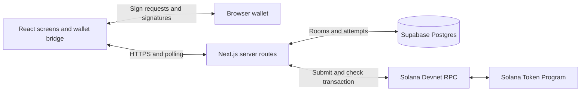

# OneTab architecture

OneTab uses one Next.js App Router application written in TypeScript. React renders the desktop interface. Next.js Route Handlers coordinate the checkout. Supabase Postgres stores coordination state, and Solana Devnet executes the payment.

This is the implementation target for the 24-hour MVP. The repository currently contains planning documents. The paths below become real during the assigned cards. Product requirements remain in [spec.md](../spec.md), and integration details live in [contracts.md](contracts.md).

## Runtime boundaries

The web interface and API deploy together. The initial design needs no separate backend service, worker, queue, WebSocket server, or custom Solana program. Route Handlers provide the HTTP API within the Next.js application. See the [Next.js backend guide](https://nextjs.org/docs/app/guides/backend-for-frontend).

Wallets retain private keys. The browser asks for authentication signatures and sign-only transaction approvals. The server verifies returned signatures and broadcasts the completed transaction. Funds move directly from payer token accounts to the seller token account.

The database is authoritative for membership, readiness, immutable attempt bytes and collected signatures. Chain observations determine payment results. A database status alone never proves payment.

## Stack decisions

| Area | Decision |
| --- | --- |
| Application | Next.js App Router, React and TypeScript with strict type checking |
| Package manager | npm with one committed package-lock.json, owned by Frontend |
| Styling | Tailwind CSS 4 with only the tokens in the [design system](design-system.md). Tailwind's default palette, scale, radii, shadows, breakpoints and widths are disabled |
| API | Same-origin JSON Route Handlers under src/app/api/ |
| Authentication | Wallet-signed challenge and opaque, short-lived session cookie |
| Storage | Supabase Postgres, accessed through server-owned operations |
| Updates | Polling, initially every two seconds while the room is visible |
| Wallet and Solana packages | P1 proves a compatible desktop combination and records exact versions before F2 integrates it |
| Network | Devnet only, verified USDC mint and prepared token accounts |
| Hosting | B5 selects a provider that supports the Node.js runtime and records the public URL |

Solana Kit and Wallet Standard integration are the starting candidates from the brief. They are not a compatibility claim. P1 records the working choice in docs/evidence/payment-proof.md. Frontend adds that choice to the shared manifest and lockfile.

## Module and file ownership

F1 created the Frontend paths listed below, except the wallet paths that F2 creates. The other owners' paths are still agreed destinations.

| Owner | Destination | Responsibility |
| --- | --- | --- |
| @Quantomz | src/app/page.tsx | Create checkout |
| @Quantomz | src/app/checkouts/[id]/page.tsx | Shared checkout room |
| @Quantomz | src/app/checkouts/[id]/result/page.tsx | Shared result and receipt |
| @Quantomz | src/app/layout.tsx, src/app/globals.css, src/app/not-found.tsx, src/app/error.tsx, src/components/, src/client/ | Layout, design tokens, screens, page states, polling and API client |
| @Quantomz | src/app/samples/, src/client/fixtures.ts | The sample data index and the rules that select sample data |
| @Quantomz | src/client/contracts.ts, src/client/fixture-data.ts | Interim copies of the contracts and sample snapshots. Deleted when B1 publishes src/contracts/ and src/fixtures/ |
| @Quantomz | src/lib/wallet/, src/components/wallet/, src/components/viewer.tsx | Wallet session machine, WalletBridge and sign-in seams, sample wallet, wallet controls, and the component that gives screens the signed-in identity |
| @Quantomz | package.json, package-lock.json, .nvmrc, tsconfig.json, next.config.ts, eslint.config.mjs, vitest.config.ts, playwright.config.ts | One application scaffold, shared dependencies and test configuration |
| @Quantomz | scripts/, e2e/, .github/workflows/ci.yml | Design checks, browser tests and CI |
| @Quantomz | docs/design-system.md, docs/design-decisions.md | The UI contract and its reasoning |
| @SophiaChua | src/contracts/, src/fixtures/ | Shared types, runtime input schemas and fixture responses |
| @SophiaChua | src/server/auth/, src/server/rooms/, src/server/db/, src/server/attempt-store/ | Sessions, room operations, database adapter and AttemptStore |
| @SophiaChua | src/app/api/config/, src/app/api/auth/, src/app/api/checkouts/route.ts, src/app/api/checkouts/[id]/route.ts, its join/ and readiness/ children | Configuration, authentication and room endpoints |
| @kyusuku | src/lib/payments/ | Browser-safe transaction decoding and validation, with no database or secret imports |
| @kyusuku | src/server/payments/ | Transaction construction, signature verification, submission and reconciliation |
| @kyusuku | src/app/api/checkouts/[id]/attempts/, src/app/api/attempts/ | Payment endpoints |
| @SophiaChua | supabase/migrations/, docs/deployment.md, docs/demo.md, docs/submission.md | Schema, hosting and submission handoff |
| @kyusuku | spikes/payment-proof/, docs/evidence/payment-proof.md | Isolated wallet experiment and evidence |

Frontend ownership of src/app/ excludes API route files. The filesystem parameter [id] corresponds to checkoutId in the API contract. A lane asks the listed owner to change shared files. Backend exposes one session guard for both room and payment routes. Payment owners do not create a second authentication implementation.

Browser modules may import src/contracts/ and browser-safe src/lib/payments/ modules. They must not import src/server/, and ESLint rejects such an import. Server-only modules protect privileged configuration and database access. Payment orchestration depends on AttemptStore; AttemptStore never imports payment orchestration.

Pages get their data only through src/client/checkout-source.ts, the one module that reads `ONETAB_FIXTURES` or calls `notFound()`. Each screen is a pure function of one `CheckoutState`, and src/client/checkout-view.ts holds every rule about what a viewer sees. Pages render the screens through `Viewer` in src/components/viewer.tsx, which replaces the loaded session with the wallet's signed-in identity, so an account switch updates every screen without a reload. F4's poller joins `Viewer`, so identity and polling meet in one component and the screens stay pure. It may move a viewer to a state's owner screen only when the polled state changes owner, never on first load. F3 fills the live branches of checkout-source.ts. F3 to F5 add the live calls for create, join, readiness, start, approve and retry inside `ActionGroup` in src/components/actions.tsx and nowhere else.

The wallet session lives in src/lib/wallet/. machine.ts is a pure state machine whose signed-in state holds exactly one account, so the identity always equals the wallet's current account or there is none. store.ts runs its effects and sends sign-in calls one at a time, because the browser has one session cookie. A wallet reaches the machine only through the `WalletBridge` and `SignInService` ports in environment.ts. sample.ts implements both for sample data, and live.ts calls B2's routes and holds the seam where P1's proven Wallet Standard adapter replaces the stand-in that reports sign-in as unavailable. ESLint keeps any future `@wallet-standard/*` import inside src/lib/wallet/.

When P1 records its proven package set, the adapter that replaces the stand-in in live.ts follows P1's spike in `spikes/payment-proof/src/wallet.ts`. It discovers wallets with `getWallets()` and clears the connection when the wallet unregisters. It reports account changes from `standard:events`, including a change between the user's approval and the subscription. It checks before and after every prompt that the account is still the selected one, as P1's `assertCurrent` does. It maps only provider code 4001 to a rejection and every other provider error to a neutral failure, and it refuses a wallet without Devnet, message signing and transaction signing at connect.

## Checkout execution

1. The organizer authenticates, creates a checkout and receives slot zero. Backend calculates immutable integer-unit shares.
2. Other wallets authenticate and claim distinct slots. Database operations prevent overfilling or duplicate wallets.
3. Everyone marks Ready. The organizer prepares an attempt. One database transaction checks readiness, reserves the attempt and freezes its participant snapshot.
4. Payments validates accounts and funds, creates the fixed message and stores its bytes and lifetime. Only then can browsers request signatures.
5. Each browser decodes and validates the complete message against the room. The wallet signs it without broadcasting. The server verifies and stores only the expected signature.
6. The last valid signature triggers a bounded submission attempt. The database persists the signed transaction and its reference before any broadcast.
7. The server checks that transaction's chain status. The room polls persisted results and authenticated payers can request another bounded reconciliation pass.

Solana signatures cover the exact message bytes. Changing the blockhash or payment contents requires fresh signatures. See [partial signing](https://solana.com/docs/core/transactions/partial-signing).

## Persistence and request recovery

Database transactions and uniqueness constraints enforce shared invariants. In-memory locks cannot protect concurrent requests or survive restarts. The [AttemptStore contract](contracts.md#attemptstore) defines the operations that must be atomic.

A preparation lease allows another request to resume the same attempt after its owner crashes. Before message publication, the resumed request can finish construction. Once published, that attempt's message never changes.

A submission lease coordinates network work. Its expiry permits another request to check or resend the same stored bytes. It does not permit a new message. Multiple broadcasts of the same transaction identity are acceptable. Application-level exactly-once RPC delivery is not assumed.

Route requests do bounded work and return the current state. No handler waits indefinitely for other payers or relies on a background promise after responding. Room GET requests read data. Protected refresh requests reconcile and persist chain observations.

F4 and F5 implement the progress driver. While a room is visible, poll its snapshot every two seconds. If the current session belongs to the frozen attempt and the attempt is neither confirmed nor safe to retry, also call its refresh endpoint. Keep one refresh request in flight per browser and back off on rate limits or network errors. Resume on focus and reconnect. A public spectator only reads snapshots.

If the session expires, public snapshots remain readable but refresh cannot advance the attempt. Prompt the participant to authenticate the same wallet again, then resume that attempt. Reauthentication does not create a replacement payment or reuse an old payment prompt.

Refresh can recover abandoned preparation for the same reserved attempt, start submission when all stored signatures are valid, and reconcile an existing submission. It never reserves a replacement. Stop active refresh after a successful receipt or canRetry=true. A new attempt still requires the organizer's explicit action.

When every browser closes, application reconciliation pauses. An already-broadcast transaction can still settle. Reopening the room resumes observation of that transaction. This MVP has no unattended settlement worker.

The blockhash is obtained at confirmed commitment. Preflight uses the same commitment. The MVP shows a successful receipt only after finalized chain status with no execution error. Earlier confirmation remains in progress. An RPC timeout or missing status is not proof of failure. Expiration and retry decisions follow [Solana confirmation guidance](https://solana.com/developers/cookbook/transactions/confirmation).

## Database and authentication boundaries

Browser clients call the Next.js API. They do not write checkout tables directly. The server validates the opaque wallet session, role and input before database access.

B2 stores only a hash of the random session token. The cookie is HttpOnly, SameSite=Lax and Secure on HTTPS. Mutation requests require the configured origin. Authentication challenges are single-use, expire, and bind the wallet, domain and purpose. Wallet changes end the previous session before another identity joins or signs.

Supabase tables have RLS enabled and deny direct anon/authenticated access. Privileged server access does not replace API authorization. Atomic SQL functions use the least privileges needed and restrict execution to the backend role. Any security-definer helper belongs outside exposed schemas. See [Supabase API security](https://supabase.com/docs/guides/api/securing-your-api).

Secrets, session tokens, raw authentication signatures and fully signed transaction bytes stay out of public snapshots and logs. Public snapshots expose payment status and the submitted transaction reference, not reusable authorization material.
