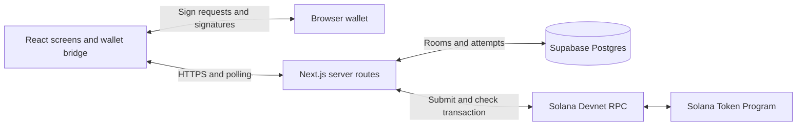

# OneTab architecture

OneTab uses one Next.js App Router application written in TypeScript. React renders the desktop interface. Next.js Route Handlers coordinate the checkout. Supabase Postgres stores coordination state, and Solana Devnet executes the payment.

This is the implementation target for the 24-hour MVP. The repository currently contains planning documents. The paths below become real during the assigned cards. Product requirements remain in [spec.md](../spec.md), and integration details live in [contracts.md](contracts.md).

## Runtime boundaries

The web interface and API deploy together. The initial design needs no separate backend service, worker, queue, WebSocket server, or custom Solana program. Route Handlers provide the HTTP API within the Next.js application. See the [Next.js backend guide](https://nextjs.org/docs/app/guides/backend-for-frontend).

Wallets retain private keys. The browser asks for authentication signatures and sign-only transaction approvals. The server verifies returned signatures and broadcasts the completed transaction. Funds move directly from payer token accounts to the seller token account.

The database is authoritative for membership, readiness, immutable attempt bytes and collected signatures. Chain observations determine payment results. A database status alone never proves payment.

## Stack decisions

| Area | Decision |
| --- | --- |
| Application | Next.js App Router, React and TypeScript with strict type checking |
| Package manager | npm with one committed package-lock.json, owned by Frontend |
| Styling | Tailwind CSS 4 with only the tokens in the [design system](design-system.md). Tailwind's default palette, scale, radii, shadows, breakpoints and widths are disabled |
| API | Same-origin JSON Route Handlers under src/app/api/ |
| Authentication | Wallet-signed challenge and opaque, short-lived session cookie |
| Storage | Supabase Postgres, accessed through server-owned operations |
| Updates | Polling, initially every two seconds while the room is visible |
| Wallet and Solana packages | P1 proves a compatible desktop combination and records exact versions before F2 integrates it |
| Network | Devnet only, verified USDC mint and prepared token accounts |
| Hosting | B5 selects a provider that supports the Node.js runtime and records the public URL |

Solana Kit and Wallet Standard integration are the starting candidates from the brief. They are not a compatibility claim. P1 records the working choice in docs/evidence/payment-proof.md. Frontend adds that choice to the shared manifest and lockfile.

## Module and file ownership

F1 created the Frontend paths listed below, except the wallet paths that F2 creates. The other owners' paths are still agreed destinations.

| Owner | Destination | Responsibility |
| --- | --- | --- |
| @Quantomz | src/app/page.tsx | Create checkout |
| @Quantomz | src/app/checkouts/[id]/page.tsx | Shared checkout room |
| @Quantomz | src/app/checkouts/[id]/result/page.tsx | Shared result and receipt |
| @Quantomz | src/app/layout.tsx, src/app/globals.css, src/app/not-found.tsx, src/app/error.tsx, src/components/, src/client/ | Layout, design tokens, screens, page states, polling and API client |
| @Quantomz | src/app/samples/, src/client/fixtures.ts | The sample data index and the rules that select sample data |
| @Quantomz | src/client/contracts.ts, src/client/fixture-data.ts | Interim copies of the contracts and sample snapshots. Deleted when B1 publishes src/contracts/ and src/fixtures/ |
| @Quantomz | src/lib/wallet/, src/components/wallet/, src/components/viewer.tsx | Wallet session machine, WalletBridge and sign-in seams, sample wallet, wallet controls, and the component that gives screens the signed-in identity |
| @Quantomz | package.json, package-lock.json, .nvmrc, tsconfig.json, next.config.ts, eslint.config.mjs, vitest.config.ts, playwright.config.ts | One application scaffold, shared dependencies and test configuration |
| @Quantomz | scripts/, e2e/, .github/workflows/ci.yml | Design checks, browser tests and CI |
| @Quantomz | docs/design-system.md, docs/design-decisions.md | The UI contract and its reasoning |
| @SophiaChua | src/contracts/, src/fixtures/ | Shared types, runtime input schemas and fixture responses |
| @SophiaChua | src/server/auth/, src/server/rooms/, src/server/db/, src/server/attempt-store/ | Sessions, room operations, database adapter and AttemptStore |
| @SophiaChua | src/app/api/config/, src/app/api/auth/, src/app/api/checkouts/route.ts, src/app/api/checkouts/[id]/route.ts, its join/ and readiness/ children | Configuration, authentication and room endpoints |
| @kyusuku | src/lib/payments/ | Browser-safe transaction decoding and validation, with no database or secret imports |
| @kyusuku | src/server/payments/ | Transaction construction, signature verification, submission and reconciliation |
| @kyusuku | src/app/api/checkouts/[id]/attempts/, src/app/api/attempts/ | Payment endpoints |
| @SophiaChua | supabase/migrations/, docs/deployment.md, docs/demo.md, docs/submission.md | Schema, hosting and submission handoff |
| @kyusuku | spikes/payment-proof/, docs/evidence/payment-proof.md | Isolated wallet experiment and evidence |

Frontend ownership of src/app/ excludes API route files. The filesystem parameter [id] corresponds to checkoutId in the API contract. A lane asks the listed owner to change shared files. Backend exposes one session guard for both room and payment routes. Payment owners do not create a second authentication implementation.

Browser modules may import src/contracts/ and browser-safe src/lib/payments/ modules. They must not import src/server/, and ESLint rejects such an import. Server-only modules protect privileged configuration and database access. Payment orchestration depends on AttemptStore; AttemptStore never imports payment orchestration.

Pages get their data only through src/client/checkout-source.ts, the one module that reads `ONETAB_FIXTURES` or calls `notFound()`. For a live checkout it reads GET /api/checkouts/:checkoutId on the server from `ONETAB_API_ORIGIN`, else `APP_ORIGIN`, and never from the request's Host header. The checkout layout makes that read before the loading placeholder streams. Only the contract's `CHECKOUT_NOT_FOUND` returns a real 404, and any other failure, such as an outage or a route that isn't deployed yet, reaches the error page. React's `cache` gives the layout, the title and the page one read per request. A failed live room read happens twice, because Next renders the error page in a second pass whose `generateMetadata` reads again outside React's request cache. The create page reads GET /api/config the same way.

Each screen is a pure function of one `CheckoutState`, which holds the room snapshot, the session, where the data came from and the page facts. The network label comes from the snapshot. src/client/checkout-view.ts holds every rule about what a viewer sees. Pages render the screens through `Viewer` in src/components/viewer.tsx, which replaces the loaded session with the wallet's signed-in identity, so an account switch updates every screen without a reload. For a live checkout, `Viewer` also shows the newest room that a browser request returned. The tracker that `live.tracker` in src/client/live-actions.ts builds is the only writer of that room. The last request sent wins. A read sent while a write is in flight never shows, and neither does a read that was still in flight when a write started, so no room lands between a click and its answer. `LiveCheckout` in viewer.tsx starts `live.watch`, the only poller, with that tracker, so identity and polling meet in one component and the screens stay pure. The poller reads at once, so a page that browser Back restores without a request catches up. It then reads every two seconds while the page is visible, keeps one poll in flight, doubles its wait after a failure up to 30 seconds, and polls at once on focus, on showing the page again and on coming back online. `pollPlan` decides what each poll sends. A payer of an attempt that is neither confirmed nor safe to retry also calls the attempt's refresh route, alongside the room read rather than before it. Polling stops once `situationOf` says paid, the same decision that puts a receipt on screen, so a paid room whose receipt doesn't check out keeps being read. The live actions keep one refresh in flight for the page, so a watch that remounts skips the refresh while an earlier one is pending, and a stopped watch sends nothing more. `pageMoves` in live-actions.ts decides when `LiveCheckout` moves a viewer to the state's owner screen, using the rule in `moveFor`. A room from this page's own write moves the viewer whenever another screen owns it. A polled room moves the viewer when its owner differs from the baseline, which is the owner of the last room the page showed. Before the page shows one, the baseline depends on how the page was reached. A page loaded or reloaded in full starts from the owner of the room it loaded with, so a replacement that the first read after an outage shows still moves the viewer. A page that an owner-change move opened, as `live.arrivals` tells it, starts from its own screen, so a room that changes owner again before the page's first read answers still moves the viewer. Back, Forward and links start from their first room read, so a page restored by Back never bounces. If this page's own write starts before that read, the tracker reports it and the baseline becomes the page's own screen, because the viewer acted there. So a Start or Try again whose own room read failed still moves the organizer when the next poll shows the room. A page opened on the screen that doesn't own the room stays put, shows the state, and links to the owner screen. The exception is a page that a move opened, which moves on its first read if the room changed owner again. After a move, the screen it opens focuses its status block once, through the `live.arrivals` flag, so a screen reader reads the new status first. A move ends when the app shows any other address. `ArrivalWatcher` in src/components/arrival-watcher.tsx, which the root layout renders, hands each committed path to `live.arrivals.seen`, so a move whose page the viewer left before it opened can't make a later Back to that page count as the move. A direct load or a reload never moves focus.

Every request to a contract route goes through `send` in src/client/api.ts, F2's sign-in client included. ESLint keeps components and pages from importing it. `ActionGroup` in src/components/actions.tsx starts every live call through `live.run` in src/client/live-actions.ts, and nothing else starts one. An action is live when `ACTIONS` in src/client/catalog.ts gives it a busy label, and the `RUN` table in live-actions.ts must then have a row for it.

| Action | Requests | What the screen shows |
| --- | --- | --- |
| `create_checkout` | POST /api/checkouts | Opens the new room |
| `join`, `mark_ready`, `mark_not_ready` | POST join, or PUT readiness | The room the server answers with |
| `start_payment`, `retry` | POST attempts naming no attempt or the one to replace, then GET the room in the same write after a success, a funding refusal, or any answer read as `refused` or `unavailable` | The room read inside the write |
| `decline` | POST decline, then GET the room | The room read after the write |
| `approve` | GET signing-payload, the payment check, one wallet prompt, POST signatures, then GET the room | The room read after the upload |

An attempt route answers with an attempt, and the screen shows only rooms, so `writeThenReadRoom` runs the write and a room read under one tracked ticket. A poll sent meanwhile can't show the room from before the write. A failed request goes through the `AFTER` table, keyed by `RequestProblem`. A problem that means the room moved on, such as a full room or a 409 about room state, reads the room again so the screen explains it. Each such row names the notice for when that read shows the room and for when it can't, so `room_changed` says the screen shows the latest only when it does. Only approve's context reaches the signer and the payment check.

Start and Try again share `startAttempt` in live-actions.ts. Start sends `retryOfAttemptId: null`, and Try again sends the attempt it replaces. The start and the room read after it run under the start's own write ticket, so no poll shows a room while the action is still answering. The read also follows every funding refusal and every answer that `api.ts` reads as `refused` or `unavailable`, such as a 400, 403, 404 or 503, no answer, an unparseable 2xx or an unknown code. Payments may store the new attempt as failed before it answers some of those, and the page can't tell which. Other answers take their own paths. A 409 about room state or a full room goes through `settle`, which reads the room again on its own read ticket. A 401 or a 429 reads nothing. The room the action read reaches `moveFor` as this page's own write, so it moves the organizer even on a page reached inside the app before any poll answered. A success leaves a preparing attempt, which the room owns, so the move takes every viewer, the organizer included, to the room for fresh approvals. A replay after a lost answer returns the same replacement, and a stale id answers `RETRY_BLOCKED`, which reads the room again.

What the action says follows from how the start was answered and the room it read. A left attempt is one that room shows as failed and never sent, other than the one being replaced.

| The start | The room read | Start says | Try again says |
| --- | --- | --- | --- |
| Answered or refused, and a left attempt shows | Answered | Nothing, because the move to the result is its answer | The new try stopped, about the left attempt |
| Answered, and no left attempt shows | Answered | Nothing | Nothing |
| Refused, and no left attempt shows | Answered | The refusal's notice | The refusal's notice |
| Answered | Failed | Nothing, because it landed unseen | Nothing |
| Refused for funding | Failed | The cause's notice | The cause's notice, about the replaced attempt still on screen |
| Refused or unavailable, not for funding | Failed | `start_unread`, which claims nothing about what changed | `start_unread` |

A wallet that can't fund the payment makes the server keep the attempt, failed, and answer 422 without its id. On that 422 the start path tells `live`'s note store to expect the cause on this checkout, before the room read. Every room the tracker shows passes through the store first. Another checkout's room drops the expectation, and each Start or Try again press clears it before sending, so a later refusal can't pick up an older cause. The next shown room of the same checkout with an attempt other than the one being replaced settles the expectation, and the cause is noted on that attempt only if it failed before it was sent. A room with no attempt, or with the replaced one, leaves the expectation waiting. So the start path's own read usually shows the failed attempt with its cause already noted, and when that read fails the cause binds on the next room shown. A second organizer tab that starts a payment between the 422 and the next shown room can attach the note to its own attempt, which changes only words.

`CheckoutState.page` holds what this page knows that the public room doesn't say. `noted` lists the causes this page's own starts heard. It comes from `live.noted`, which lives per page beside the refresh lock, keeps the first note for each attempt, survives the move between the room and the result, and clears on a reload. `roomUnreachable` says the latest room read failed. Page facts change words only: checkout-view.test.ts proves that every sample, viewer and page fact offers the same actions. A failed attempt's reason takes, in order, network rejected when it was sent, the room's error code, this page's note for that exact attempt, and the not-sent line. The view never reads the server's error message or explorer URL. The tracker reports whether the newest answered request reached the room: reachable when it shows a room, a write's included, and unreachable for a failed read. It skips any answer older than one it already showed or reported, so an older room that answers after a newer read failed shows without clearing the line. `LiveCheckout` is the only place that turns that report into `roomUnreachable`, which shows the connection line on both screens. The status line, the connection line and the stop reason sit in one polite live region, so a screen reader hears each change.

Only `replaceable()` in checkout-view.ts makes the `Replaceable` attempt id that Try again sends, and only for a failed or expired attempt with `canRetry`. Only `verifiedReceipt()` makes the `VerifiedReceipt` that the receipt view takes. The room is paid, its spots are exactly 1 to the payer count, once each and each on its own wallet, and its newest attempt is confirmed with every payer's approval. The receipt names that attempt's reference, which must decode to a 64-byte signature, this checkout's seller and total, and every share in spot order, and the shares add up to the total. The explorer link is built from that reference. The result's actions come from the classification, the viewer's role and the links, never from a body that carries page facts. Neither brand is exported. ESLint bans importing either brand from checkout-view and a cast that names either brand anywhere in its type, everywhere else in src, and brand-fence.test.ts proves the fence through ESLint's Node API. Some paths still pass, and these are examples, not a complete list. One is a cast to an exported type that holds a brand, such as `as Action`, `as ActionOf<"retry">` or `as Recovery`, or a generic `as T` helper. Another is a type guard that claims such a type, such as `(v: unknown): v is ActionOf<"retry"> => true`. brand-fence.test.ts pins that the fence misses both. Others are a cast to an indexed-access type that resolves to a brand without naming it, and a value typed `any`.

Approve fetches the signing payload and hands it to `checkPayment` in src/client/payment-check.ts with the `ApprovalTerms` that drew the approval summary, so the wallet is asked to approve only the payment the payer read. The check compares the payload's fields with the terms, including the equal split that spec.md requires, then runs Payments' byte check through the `MessageCheck` seam. Until P2 exports its validator from src/lib/payments, that seam answers `unsupported` and a live Approve opens no wallet. A payload that arrives but doesn't parse, or names another attempt, reads as a mismatch, never as an outage. After the wallet answers and before the upload, the `ReturnCheck` seam beside it runs P3's check of the returned signature. It also fails closed until P3's export is wired, and a failed return check uploads nothing. Only the check can make a `CheckedPayment`, and `PaymentSigner.keptOrNewApproval` in src/lib/wallet/environment.ts takes nothing else. environment.ts and store.ts import that type from payment-check with `import type`, which leaves no runtime edge from the wallet code to the check. Components get the signer from `useWalletSession()`, bound to the sign-in of the render that offered Approve. `SessionStore.keptOrNewApproval` in store.ts holds the payment prompt, because the store lives in the root layout and outlives a move between the room and the result. It opens one prompt per page, returns a cached approval for the same message in the same sign-in so a lost upload is resent without a prompt, and drops any answer once the sign-in changes. Approve drops a cached approval that the return check or the server refuses, so the next Approve opens the wallet again. Right before the upload, Approve checks that the sign-in that opened the prompt is still the page's, as P1's `assertCurrent` does, and uploads nothing if it changed. Its `waitingOnPrompt` value names the attempt the page waits on. It drives the wallet status line on every screen, and shows Approve as busy only for that attempt. The prompt lock is per page, because each tab has its own root layout and store. Two tabs of one browser can each open a payment prompt, so the payer can see the same payment twice in the wallet. Both prompts ask to approve the same message. The refresh lock is per page too, because each tab loads its own `live` from live-actions.ts, so two tabs of one room can each have a refresh request in flight. ESLint keeps pages and components from importing payment-check, however the path is spelled and including a dynamic `import()`, and only live-actions.ts and tests may import the `paymentCheck` factory. In browser code, which is src/client, src/components, src/lib/wallet and the pages, it also bans Wallet Standard's sign-and-send feature, the RPC and send factories of `@solana/kit`, and the RPC factories of `@solana/rpc`, because the browser only asks a wallet to approve and the server sends the one payment. src/server and src/app/api may send. These fences cover .js and .jsx files too.

The wallet session lives in src/lib/wallet/. machine.ts is a pure state machine whose signed-in state holds exactly one account, so the identity always equals the wallet's current account or there is none. store.ts runs its effects and sends sign-in calls one at a time, because the browser has one session cookie. A wallet reaches the machine only through the `WalletBridge` and `SignInService` ports in environment.ts. sample.ts implements both for sample data, and live.ts calls B2's routes and holds the seam where P1's proven Wallet Standard adapter replaces the stand-in that reports sign-in as unavailable. ESLint keeps any future `@wallet-standard/*` import inside src/lib/wallet/.

When P1 records its proven package set, the adapter that replaces the stand-in in live.ts follows P1's spike in `spikes/payment-proof/src/wallet.ts`. It discovers wallets with `getWallets()` and clears the connection when the wallet unregisters. It reports account changes from `standard:events`, including a change between the user's approval and the subscription. It checks before and after every prompt that the account is still the selected one, as P1's `assertCurrent` does. It maps only provider code 4001 to a rejection and every other provider error to a neutral failure, and it refuses a wallet without Devnet, message signing and transaction signing at connect. Its `signPayment` follows the contract on `WalletBridge.signPayment` in environment.ts, using P1's order and P3's `verifyWalletSignature` from src/lib/payments.

## Checkout execution

1. The organizer authenticates, creates a checkout and receives slot zero. Backend calculates immutable integer-unit shares.
2. Other wallets authenticate and claim distinct slots. Database operations prevent overfilling or duplicate wallets.
3. Everyone marks Ready. The organizer prepares an attempt. One database transaction checks readiness, reserves the attempt and freezes its participant snapshot.
4. Payments validates accounts and funds, creates the fixed message and stores its bytes and lifetime. Only then can browsers request signatures.
5. Each browser decodes and validates the complete message against the room. The wallet signs it without broadcasting. The server verifies and stores only the expected signature.
6. The last valid signature triggers a bounded submission attempt. The database persists the signed transaction and its reference before any broadcast.
7. The server checks that transaction's chain status. The room polls persisted results and authenticated payers can request another bounded reconciliation pass.

Solana signatures cover the exact message bytes. Changing the blockhash or payment contents requires fresh signatures. See [partial signing](https://solana.com/docs/core/transactions/partial-signing).

## Persistence and request recovery

Database transactions and uniqueness constraints enforce shared invariants. In-memory locks cannot protect concurrent requests or survive restarts. The [AttemptStore contract](contracts.md#attemptstore) defines the operations that must be atomic.

A preparation lease allows another request to resume the same attempt after its owner crashes. Before message publication, the resumed request can finish construction. Once published, that attempt's message never changes.

A submission lease coordinates network work. Its expiry permits another request to check or resend the same stored bytes. It does not permit a new message. Multiple broadcasts of the same transaction identity are acceptable. Application-level exactly-once RPC delivery is not assumed.

Route requests do bounded work and return the current state. No handler waits indefinitely for other payers or relies on a background promise after responding. Room GET requests read data. Protected refresh requests reconcile and persist chain observations.

F4 and F5 implement the progress driver. While a room is visible, poll its snapshot every two seconds. If the current session belongs to the frozen attempt and the attempt is neither confirmed nor safe to retry, also call its refresh endpoint. Keep one refresh request in flight per page and back off on rate limits or network errors. Resume on focus and reconnect. A public spectator only reads snapshots.

If the session expires, public snapshots remain readable but refresh cannot advance the attempt. Prompt the participant to authenticate the same wallet again, then resume that attempt. Reauthentication does not create a replacement payment or reuse an old payment prompt.

Refresh can recover abandoned preparation for the same reserved attempt, start submission when all stored signatures are valid, and reconcile an existing submission. It never reserves a replacement. Stop active refresh after a successful receipt or canRetry=true. A new attempt still requires the organizer's explicit action.

When every browser closes, application reconciliation pauses. An already-broadcast transaction can still settle. Reopening the room resumes observation of that transaction. This MVP has no unattended settlement worker.

The blockhash is obtained at confirmed commitment. Preflight uses the same commitment. The MVP shows a successful receipt only after finalized chain status with no execution error. Earlier confirmation remains in progress. An RPC timeout or missing status is not proof of failure. Expiration and retry decisions follow [Solana confirmation guidance](https://solana.com/developers/cookbook/transactions/confirmation).

## Database and authentication boundaries

Browser clients call the Next.js API. They do not write checkout tables directly. The server validates the opaque wallet session, role and input before database access.

B2 stores only a hash of the random session token. The cookie is HttpOnly, SameSite=Lax and Secure on HTTPS. Mutation requests require the configured origin. Authentication challenges are single-use, expire, and bind the wallet, domain and purpose. Wallet changes end the previous session before another identity joins or signs.

Supabase tables have RLS enabled and deny direct anon/authenticated access. Privileged server access does not replace API authorization. Atomic SQL functions use the least privileges needed and restrict execution to the backend role. Any security-definer helper belongs outside exposed schemas. See [Supabase API security](https://supabase.com/docs/guides/api/securing-your-api).

Secrets, session tokens, raw authentication signatures and fully signed transaction bytes stay out of public snapshots and logs. Public snapshots expose payment status and the submitted transaction reference, not reusable authorization material.
